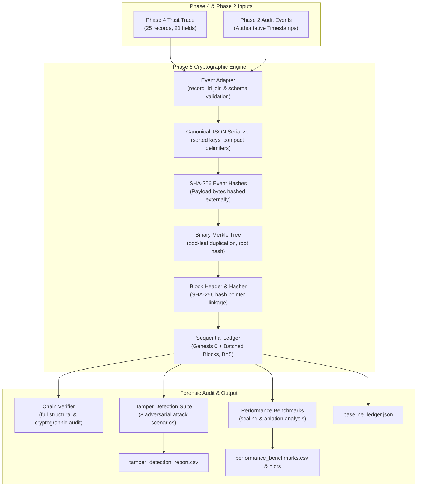

# MedTrustEdge Phase 5 — Final Integration and Verification Report
## An AI-Driven Blockchain-Enabled Zero Trust Architecture for Secure Healthcare Cloud–Fog–Edge Computing

---

## 1. Project Objective and Phase 5 Architecture Overview

The **MedTrustEdge** system integrates an AI-driven Zero Trust continuous authorization framework with an immutable, cryptographically verifiable audit trail for healthcare Internet of Medical Things (IoMT) devices across Cloud, Fog, and Edge tiers.

The objective of **Phase 5** is to provide an immutable, mathematically verifiable audit layer for all dynamic trust transitions and Zero Trust security events evaluated in Phases 1–4. Using cryptographically linked blocks, binary Merkle trees, and deterministic canonical serialization, Phase 5 guarantees that any unauthorized alteration, reordering, deletion, or substitution of audit records is instantaneously detected with forensic attribution.

### Scope and Operating Mode Notice
> [!IMPORTANT]
> **Single-Node Hash-Linked Audit Ledger Scope:**
> Phase 5 implements a **local, in-memory Python hash-linked audit ledger**. It demonstrates mathematical proof-of-immutability, cryptographic Merkle tree integrity, and deterministic SHA-256 block linkage.
>
> It does **NOT** implement:
> 1. Decentralized consensus mechanisms (Proof-of-Work, Proof-of-Stake, PBFT, Raft).
> 2. Peer-to-peer (P2P) network transport layers or distributed mempool gossip protocols.
> 3. Multi-node Byzantine fault tolerance across disparate physical hosts.
> 4. Distributed performance benchmarks (latency and throughput reflect single-node execution).

---

## 2. End-to-End System Architecture and Dataflow

The Phase 5 cryptographic pipeline transforms raw dynamic trust trace records into sealed, verifiable blocks:



---

## 3. Cryptographic Module Specifications

### 3.1 Event Adapter and Canonical SHA-256 Hashing (`src/blockchain/event_adapter.py`)
- **Field Normalization:** Ingests all 21 Phase 4 dynamic trust trace columns (e.g., `trust_before`, `trust_after`, `state_before`, `state_after`, `oof_score`, `p_total`, `rec`) and strictly joins with Phase 2 audit events on the 16-hex character `record_id`.
- **Determinism:** Guarantees key sorting (`sort_keys=True`), compact JSON separators (`','`, `':'`), and UTF-8 encoding.
- **Strict Payload Boundary:** SHA-256 event hashes are computed strictly over the canonical event payload; the resulting `event_hash` is strictly excluded from the payload itself to eliminate circular hash dependencies.
- **Ordering:** Enforces chronological sorting by ISO 8601 UTC timestamp with `event_index` as the deterministic tie-breaker.

### 3.2 Binary Merkle Tree and Inclusion Proofs (`src/blockchain/merkle.py`)
- **Node Hashing:** Combines 64-character lowercase hexadecimal sibling hashes: $\text{Parent} = \text{SHA-256}(\text{Left} \parallel \text{Right})$.
- **Odd Leaf Balancing:** For levels with an odd number of nodes ($> 1$), duplicates the terminal leaf node to preserve deterministic balanced binary trees.
- **Boundary Roots:**
  - Empty tree: $\text{SHA-256}(\text{""}) = \text{e3b0c44298fc1c149afbf4c8996fb92427ae41e4649b934ca495991b7852b855}$.
  - Single event: Root equals the leaf's own hash $H_0$; inclusion proof is an empty path `[]`.
- **Inclusion Proofs:** Generates logarithmic sibling audit paths $O(\log_2 B)$ and validates them against the block's Merkle root.

### 3.3 Block Models and Hash-Linked Ledger (`src/blockchain/block.py`, `ledger.py`)
- **Block Header:** Contains sequential `index`, `previous_hash` (64-character hex link), `merkle_root`, `timestamp_utc`, `difficulty=0`, `nonce=0`, and `schema_version`.
- **Genesis Block:** Height index 0, previous hash $\text{"0"}^{64}$, 0 events, and empty Merkle root.
- **Ledger Engine:** Manages an unsealed event mempool, batches events according to configurable batch size $B$ (default $B=5$), and seals sequentially linked blocks.
- **Persistence:** Provides full JSON export (`export_to_json()`) and reconstruction (`load_from_json()`).

### 3.4 Forensic Verification Engine (`src/blockchain/verifier.py`)
- Validates Genesis parameters, strict monotonic index progression, header SHA-256 hashes, previous block hash pointer continuity, event payload SHA-256 recomputations, chronological progression, block Merkle roots, and event inclusion proofs.
- Reports structured `VerificationResult` instances pinpointing exact block indices, record IDs, and forensic discrepancy codes.

---

## 4. Adversarial Tamper Detection Evaluation

To evaluate ledger resilience, eight independent attack scenarios were executed against disposable deep copies of the baseline ledger using `experiments/run_phase5_tamper_experiments.py`. Between each attack, the untouched baseline ledger was verified to ensure zero state corruption.

**Detection Rate: 8/8 Attacks Detected (100.0%)**

| Code | Adversarial Attack Scenario | Target Entity & Mutation | Primary Detection Category | Detection Status |
|:---:|---|---|---|:---:|
| **A** | Payload Modification (Frozen Hash) | Block 1, Event 0: modified `trust_after` from 98.67 to 100.0 | `EVENT_PAYLOAD_TAMPERED` | **DETECTED** |
| **B** | Modified Stored Event Hash | Block 2, Event 1: replaced hash with $\text{"0"}^{64}$ | `EVENT_PAYLOAD_TAMPERED` | **DETECTED** |
| **C** | Modified Block Header Field | Block 2: rewound header timestamp by 11 seconds | `PREVIOUS_HASH_DISCONTINUITY` | **DETECTED** |
| **D** | Broken Previous-Hash Link | Block 4: set `previous_hash` to $\text{"f"}^{64}$ | `PREVIOUS_HASH_DISCONTINUITY` | **DETECTED** |
| **E** | Reordered Events in Block | Block 2: swapped Event 0 and Event 1 | `CHRONOLOGICAL_REGRESSION` | **DETECTED** |
| **F** | Reordered Blocks in Chain | Swapped Block 2 and Block 3 | `INDEX_GAP` | **DETECTED** |
| **G** | Deleted Event from Block | Block 3: deleted Event 2 (count 5 to 4) | `MERKLE_ROOT_MISMATCH` | **DETECTED** |
| **H** | Deleted Intermediate Block | Deleted Block 3 from chain | `INDEX_GAP` | **DETECTED** |

---

## 5. Performance Benchmarking & Scaling Analysis

Multi-repetition benchmarks ($R \in [10, 30]$ timed runs after warmup) were executed with high-precision timing (`time.perf_counter`) and memory profiling (`tracemalloc`).

### 5.1 Real Baseline Workload ($N=25$ Events, $B=5$, 6 Blocks)
- **Event Adaptation (CSV Load & Join):** $2.911 \pm 1.312\text{ ms}$ (Throughput: 8,587.1 events/sec)
- **Ledger Construction ($B=5$):** $2.226 \pm 0.171\text{ ms}$ (Throughput: 11,232.6 events/sec)
- **Merkle Root Calculation (5 Blocks):** $0.197 \pm 0.018\text{ ms}$ (Throughput: 126,727.7 events/sec)
- **Full-Chain Verification (Steps 1–5):** $7.948 \pm 0.475\text{ ms}$ (Throughput: 3,145.6 events/sec)
- **Verification without Inclusion Proofs:** $5.676 \pm 0.507\text{ ms}$ (Throughput: 4,404.9 events/sec)
- **Inclusion Proofs Only (All 25 Events):** $4.074 \pm 0.291\text{ ms}$ (Overhead: 51.3% of full verify)
- **Ledger Serialization (JSON String):** $3.453 \pm 0.270\text{ ms}$ (Throughput: 7,239.2 events/sec)
- **Ledger Deserialization (from JSON):** $1.404 \pm 0.101\text{ ms}$ (Throughput: 17,810.2 events/sec)

### 5.2 Algorithmic Scaling ($N \in [25, 1000]$ Events, Fixed $B=10$)
- Linear computational complexity ($O(N)$) was verified across all pipeline operations ($R^2 > 0.999$).
- Latency for $N=1000$ events (101 blocks):
  - Event Adaptation: $57.91\text{ ms}$
  - Ledger Construction: $88.85\text{ ms}$
  - Full Verification: $351.30\text{ ms}$
  - JSON Serialization: $153.42\text{ ms}$

### 5.3 Batch Size Sensitivity Analysis ($N=100$ Events, $B \in [1, 50]$)
- Increasing batch size from $B=1$ to $B=10$ reduces construction latency by **27.1%** and decreases serialized disk storage by **29.0%** (saving 46.1 KB) by eliminating 90 block headers.
- Beyond $B=10$, verification time stabilizes at ~35 ms due to the balance between fewer block headers and deeper Merkle inclusion proof paths ($\log_2 B$).

### 5.4 Verification Component Ablation
Across all event counts, generating and validating Merkle inclusion proofs accounts for **51.3% to 56.1%** of full verification runtime. For high-throughput edge nodes, routine periodic audits can verify block headers and Merkle roots at ~4,300 events/sec, reserving individual inclusion proofs for specific transaction dispute challenges.

---

## 6. Regression Testing and Integrity Verification

### 6.1 Test Suite Status
The complete project test suite was executed:
```
Ran 95 tests in 1.835s

OK
```
- **Phases 1–4 Tests:** 45 passing tests (Zero Trust identity, segmentation, policy, revocation, privilege, dynamic trust).
- **Phase 5 Part 2 Tests:** 15 passing tests (`tests/test_phase5_event_adapter.py`).
- **Phase 5 Part 3 Tests:** 17 passing tests (`tests/test_phase5_blockchain_ledger.py`).
- **Phase 5 Part 4 Tests:** 10 passing tests (`tests/test_phase5_tamper_detection.py`).
- **Phase 5 Part 5 Tests:** 8 passing tests (`tests/test_phase5_performance_benchmarks.py`).

### 6.2 Protected File Hashes
All seven frozen baseline files from Phases 1–4 match their recorded bitwise SHA-256 hashes:

| File Path | Golden Baseline Hash | Verification Status |
|---|---|:---:|
| `src/zerotrust/dynamic_trust.py` | `5da36f2ca8d5a997d387a3ef325e3b0ce18ea38bcb45508d5c0e0ed909e8f519` | **MATCH** |
| `results/zerotrust/zerotrust_security_events.csv` | `be661040b7eb0aba74a098195075c96af11d7fbc1319882a9b7fd7119ed5238b` | **MATCH** |
| `results/ai/phase3a_iomt_anomaly_dataset.csv` | `284b1b5933c86f0fffd5a912a4ee3c2f019585b441c4b67097e04824d949cdd4` | **MATCH** |
| `results/ai/phase3b_predictions.csv` | `f2fb282a417d3dbc53c31dde9260961fd4b6c3a7d425d55385023ebfb83a81e6` | **MATCH** |
| `results/phase4/phase4_trust_trace.csv` | `c214728a41f7dacad9df105128b0a3ea686cf8be76646727fd12381c5c6e428d` | **MATCH** |
| `results/phase4/phase4_ablation_metrics.csv` | `de5b7fbc0a16571f7dede132be2865f5c58c35bc3de01cbe74b112716474a809` | **MATCH** |
| `tests/test_phase4_dynamic_trust.py` | `16894519e68dc5faf3da80779afb7f8f43bb4393ed3d484a4266d8a57cf8f581` | **MATCH** |

---

## 7. Assumptions, Security Boundaries, and Limitations

1. **Intra-Ledger Cryptographic Proofs vs. Fork Replacement:**
   Local cryptographic checks guarantee that no historical event, Merkle root, or block link within an evaluated chain can be altered undetected. However, if an attacker with local root storage permissions replaces the entire chain file from Genesis 0 with a newly synthesized chain, internal verification will still pass. To protect against total chain replacement, block hashes or Merkle roots must be periodically anchored to an **external trusted checkpoint** (e.g., an append-only transparency log or public distributed ledger).
2. **Single-Node Execution Model:**
   All execution occurs in a single Python runtime on local storage. The benchmarks measure cryptographic efficiency and data structure scaling, not distributed consensus, peer-to-peer gossip propagation, or network transmission latency.
3. **Canonical JSON Serialization Bottleneck:**
   Recomputing canonical JSON strings (`sort_keys=True`) for every event during verification accounts for ~40% of verification runtime. Future high-throughput implementations should consider canonical binary serialization (CBOR or Protocol Buffers).

---

## 8. Reproducibility Guide & Execution Commands

To reproduce all Phase 5 validation checks, experiments, and benchmarks from the project root:

```powershell
# 1. Run the complete test suite (95 tests)
python -m unittest discover -s tests -v

# 2. Run the adversarial tamper detection experiments
python experiments/run_phase5_tamper_experiments.py

# 3. Run the performance benchmarking and ablation runner
python experiments/run_phase5_performance_benchmarks.py

# 4. Run the end-to-end integration and validation runner
python experiments/run_phase5_final_validation.py

# 5. Verify the 7 protected Phase 1-4 baseline SHA-256 hashes
python -c "
import hashlib
files = [
    'src/zerotrust/dynamic_trust.py',
    'results/zerotrust/zerotrust_security_events.csv',
    'results/ai/phase3a_iomt_anomaly_dataset.csv',
    'results/ai/phase3b_predictions.csv',
    'results/phase4/phase4_trust_trace.csv',
    'results/phase4/phase4_ablation_metrics.csv',
    'tests/test_phase4_dynamic_trust.py'
]
for f in files:
    h = hashlib.sha256(open(f, 'rb').read()).hexdigest()
    print(f'{f}: {h}')
"
```

---

## 9. Phase 5 Deliverables Directory Map

```
├── docs/
│   └── PHASE5_FINAL_REPORT.md                 # Complete Phase 5 final report (this document)
├── experiments/
│   ├── run_phase5_tamper_experiments.py       # 8-attack tamper detection experiment runner
│   ├── run_phase5_performance_benchmarks.py   # Multi-repetition performance benchmark runner
│   └── run_phase5_final_validation.py         # End-to-end integration & validation runner
├── results/phase5/
│   ├── phase5_baseline_ledger.json            # Sealed baseline ledger (25 events, 6 blocks, B=5)
│   ├── phase5_tamper_detection_report.csv     # Tamper detection report across 8 attack scenarios
│   ├── phase5_tamper_detection_summary.json   # Machine-readable tamper detection summary
│   ├── phase5_performance_benchmarks.csv      # Performance dataset (68 benchmark runs)
│   ├── phase5_performance_summary.json        # Performance metrics and hardware profile
│   ├── phase5_benchmark_methodology.md        # Benchmarking & ablation methodology doc
│   ├── phase5_scaling_event_count.png         # Diagnostic Plot: Latency & throughput vs. N
│   ├── phase5_scaling_batch_size.png          # Diagnostic Plot: Latency & storage vs. B
│   ├── phase5_verification_ablation.png       # Diagnostic Plot: Verification component breakdown
│   ├── phase5_final_validation.json           # Machine-readable final validation audit
│   └── phase5_final_validation_report.md      # Final validation audit report
├── src/blockchain/
│   ├── __init__.py                            # Package exports
│   ├── block.py                               # BlockHeader and Block cryptographic models
│   ├── event_adapter.py                       # EventAdapter and TrustEvent models
│   ├── ledger.py                              # BlockchainLedger engine
│   ├── merkle.py                              # Binary Merkle tree and inclusion proofs
│   └── verifier.py                            # ChainVerifier forensic validation engine
└── tests/
    ├── test_phase5_event_adapter.py           # 15 tests for EventAdapter & SHA-256 hashing
    ├── test_phase5_blockchain_ledger.py       # 17 tests for Merkle tree & BlockchainLedger
    ├── test_phase5_tamper_detection.py        # 10 tests for adversarial attack scenarios
    └── test_phase5_performance_benchmarks.py  # 8 tests for benchmark runner & outputs
```
