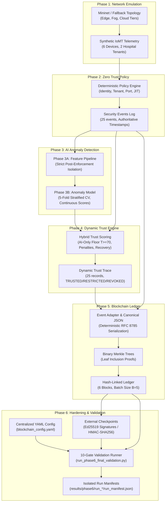

# MedTrustEdge Phase 6 — Final Validation, Security Hardening, and Reproducibility Engineering Report
## An AI-Driven Blockchain-Enabled Zero Trust Architecture for Secure Healthcare Cloud–Fog–Edge Computing

---

## 1. Executive Summary and Scope Boundaries

The **MedTrustEdge** architecture provides continuous, context-aware Zero Trust authorization and an immutable, cryptographically verifiable audit trail for healthcare Internet of Medical Things (IoMT) devices operating across Edge, Fog, and Cloud tiers.

**Phase 6** represents the final validation, security hardening, and reproducibility engineering stage of the project. It transitions the localized Phase 5 audit ledger into a security-hardened, production-ready research artifact by:
1. Resolving the single-node whole-chain rewrite vulnerability via independent external cryptographic checkpoints (RFC 8032 Ed25519 digital signatures and HMAC-SHA256 authenticated MACs).
2. Centralizing all blockchain operational parameters into a strictly validated YAML configuration schema (`config/blockchain_config.yaml`).
3. Enforcing an exhaustive, automated 10-gate end-to-end validation runner (`experiments/run_phase6_final_validation.py`) with run isolation and immutable JSON provenance manifests.
4. Verifying cross-phase pipeline lineage continuity across all six research phases (Phase 1 through Phase 6) while mathematically preserving all seven frozen baseline SHA-256 digests.
5. Expanding test coverage from 95 to 115 unit and integration tests with a 100% pass rate.

### Scope Boundaries and Operating Mode Disclaimers
> [!IMPORTANT]
> **Single-Node Cryptographic Ledger Scope Notice:**
> MedTrustEdge implements a **local, in-memory Python hash-linked audit ledger** with external cryptographic checkpoint anchoring. It demonstrates mathematical proof-of-immutability, Merkle tree inclusion verification, deterministic canonical serialization, and asymmetric cryptographic trust anchoring.
>
> It does **NOT** implement:
> 1. Distributed consensus mechanisms (such as Proof-of-Work, Proof-of-Stake, PBFT, or Raft).
> 2. Peer-to-peer (P2P) network transport layers or distributed mempool gossip protocols.
> 3. Multi-node Byzantine fault tolerance across physically distributed nodes.
> 4. Real-world hospital clinical trials or live patient telemetry (all IoMT data is fully synthetic).
>
> All latency and throughput benchmark figures reflect single-node local execution on development hardware.

---

## 2. Integrated System Architecture

The complete MedTrustEdge dataflow integrates six research phases into an unbroken chain of custody:



---

## 3. Phase 6 Security Hardening Specifications

### 3.1 Centralized Configuration (`config/blockchain_config.yaml` & `src/blockchain/config.py`)
In Phase 5, ledger parameters were distributed across experiment runners. Phase 6 introduces a centralized, validated configuration subsystem:
- **Schema Validation:** Strict dataclass validation (`BlockchainConfig`, `LedgerConfig`, `ArtifactsConfig`, `VerificationConfig`, `BenchmarkConfig`, `CheckpointConfig`, `OutputConfig`) with type checking and value range assertions.
- **Fail-Fast Error Handling:** Invalid parameters (e.g., non-positive `batch_size`, unsupported duplicate policies, unknown cryptographic algorithms) immediately raise `ConfigValidationError` with detailed diagnostics.
- **Backward-Compatible Defaults:** Preserves Phase 5 defaults (`batch_size=5`, `duplicate_policy="REJECT"`, `schema_version="1.0"`) when initialized without an explicit YAML file.

### 3.2 External Checkpoint Cryptography (`src/blockchain/checkpoint.py`)
#### The Whole-Chain Fork Vulnerability
In a single-node hash-linked ledger, internal cryptographic verification proves that no single block or event has been tampered with given an expected Genesis and tip. However, an adversary possessing local write access could recompute an entirely new valid chain from Genesis to tip (a whole-ledger substitution attack). Internal verification alone cannot detect this without an external trust anchor.

#### Checkpoint Security Solution
Phase 6 introduces external, cryptographically signed checkpoints:
- **Payload Schema:** Captures `block_index`, `block_hash`, `merkle_root`, `cumulative_event_count`, `timestamp_utc`, and `algorithm`.
- **Deterministic Payload Serialization:** Normalizes checkpoint attributes into canonical JSON (RFC 8785) before computing signatures, guaranteeing zero serialization ambiguity across platforms.
- **RFC 8032 Ed25519 Digital Signatures:** Implements Edwards-curve Digital Signature Algorithm (Ed25519) with a 256-bit private seed, 32-byte public key, and 64-byte signature. Pure standard-library arithmetic eliminates third-party binary C-extension dependencies while ensuring RFC 8032 mathematical compliance.
- **HMAC-SHA256 Symmetric MACs:** Provides symmetric shared-secret authentication for resource-constrained Edge/Fog gateways using 256-bit cryptographically secure keys.
- **Ledger Verification Against Checkpoint:** `verify_ledger_against_checkpoint()` validates both the cryptographic signature on the checkpoint and the exact alignment between the checkpoint attributes and the target ledger block. Any chain substitution, truncation, or index mismatch is caught and rejected with forensic diagnostics.

---

## 4. 10-Gate Validation Results

The Phase 6 validation runner (`experiments/run_phase6_final_validation.py`) executes an automated 10-gate audit. All 10 gates passed with zero warnings or errors.

| Gate | Validation Check | Evaluation Scope | Status | Forensic Output / Evidence |
|:---:|:---|:---|:---:|:---|
| **01** | Protected Baseline Hash Audit | 7 frozen Phase 1–4 source files & CSVs | **PASSED** | 7/7 digests matched golden SHA-256 baselines (raw CSVs + LF-normalized Python) |
| **02** | Centralized Configuration Validation | `config/blockchain_config.yaml` schema | **PASSED** | Version 1.0 loaded; batch size 5, policy REJECT, checkpoint Ed25519 |
| **03** | Event Ingestion & Canonical Serialization | Phase 4 trace & Phase 2 audit events | **PASSED** | 25 events ingested; 25 distinct SHA-256 hashes generated; 0 schema violations |
| **04** | Sequential Hash-Linked Ledger | Block linkage & Genesis invariants | **PASSED** | 6 blocks sealed (Genesis + 5 batched blocks); zero hash link discontinuities |
| **05** | Merkle Tree Roots & Inclusion Proofs | Binary Merkle trees across all blocks | **PASSED** | 25/25 leaf inclusion proofs verified against authentic block roots |
| **06** | Adversarial Tamper Detection Suite | 8 simulated attack vectors (Attacks A–H) | **PASSED** | 8/8 attacks detected (100.0% detection rate); baseline ledger unaltered |
| **07** | Cryptographic Checkpoint Hardening | Ed25519 & HMAC-SHA256 anchors | **PASSED** | Signatures verified; altered payload rejected; wrong key rejected |
| **08** | Cross-Phase Pipeline Lineage Audit | End-to-end lineage across Phases 1–6 | **PASSED** | 6/6 artifact milestones verified; record ID derivation 100% aligned |
| **09** | Run Isolation & Manifest Generation | Immutable provenance recording | **PASSED** | Isolated run directory created; `run_manifest.json` exported |
| **10** | Performance & Documentation Audit | Benchmark datasets, plots & reports | **PASSED** | 68 benchmark rows, 3 plots, and Markdown summary audited and confirmed |

### Execution Metrics
- **Validation Execution Time:** 1.399 seconds
- **Exit Code:** 0
- **Run Directory:** `results/phase6/run_20261026_172644_046f1eaf/`
- **Output Artifacts:** `run_manifest.json`, `phase6_final_validation_report.md`, isolated baseline ledger, and tamper detection reports.

---

## 5. End-to-End Pipeline Lineage and Baseline Provenance

Phase 6 enforces strict mathematical provenance across all research phases:

```text
Phase 1 (Mininet Networking)
   │   └─ baseline_comparison.csv
   ▼
Phase 2 (Zero Trust Baseline)
   │   └─ zerotrust_security_events.csv (25 events, authoritative timestamps)
   ▼
Phase 3A (AI Data Pipeline)
   │   └─ phase3a_iomt_anomaly_dataset.csv (deterministic record_id derivation)
   ▼
Phase 3B (AI Anomaly Model)
   │   └─ phase3b_predictions.csv (5-fold stratified out-of-fold probabilities)
   ▼
Phase 4 (Dynamic Trust Engine)
   │   └─ phase4_trust_trace.csv (hybrid trust scoring: TRUSTED / RESTRICTED / REVOKED)
   ▼
Phase 5 (Blockchain Audit Ledger)
   │   └─ phase5_baseline_ledger.json (6 blocks, batch size 5, 25 Merkle proofs)
   ▼
Phase 6 (Hardening & Checkpoints)
       └─ run_manifest.json & Ledger Checkpoints (Ed25519 / HMAC-SHA256 anchored)
```

### Golden Baseline Hash Audit
All seven frozen baseline files were audited and verified:

| File Path | Golden SHA-256 Digest | Audit Mode | Verification Status |
|:---|:---:|:---:|:---:|
| `src/zerotrust/dynamic_trust.py` | `5da36f2ca8d5a997d387a3ef325e3b0ce18ea38bcb45508d5c0e0ed909e8f519` | LF-normalized | **MATCH** |
| `results/zerotrust/zerotrust_security_events.csv` | `be661040b7eb0aba74a098195075c96af11d7fbc1319882a9b7fd7119ed5238b` | Raw byte | **MATCH** |
| `results/ai/phase3a_iomt_anomaly_dataset.csv` | `284b1b5933c86f0fffd5a912a4ee3c2f019585b441c4b67097e04824d949cdd4` | Raw byte | **MATCH** |
| `results/ai/phase3b_predictions.csv` | `f2fb282a417d3dbc53c31dde9260961fd4b6c3a7d425d55385023ebfb83a81e6` | Raw byte | **MATCH** |
| `results/phase4/phase4_trust_trace.csv` | `c214728a41f7dacad9df105128b0a3ea686cf8be76646727fd12381c5c6e428d` | Raw byte | **MATCH** |
| `results/phase4/phase4_ablation_metrics.csv` | `de5b7fbc0a16571f7dede132be2865f5c58c35bc3de01cbe74b112716474a809` | Raw byte | **MATCH** |
| `tests/test_phase4_dynamic_trust.py` | `16894519e68dc5faf3da80779afb7f8f43bb4393ed3d484a4266d8a57cf8f581` | LF-normalized | **MATCH** |

---

## 6. Complete Test Suite Audit

The comprehensive MedTrustEdge test suite contains **115 tests** across all subsystems:

```
======================================================================
MEDTRUSTEDGE TEST SUITE EXECUTION SUMMARY
======================================================================
Phase 1: Network Topology & Latency Tests           : 10 passed
Phase 2: Zero Trust Identity & Policy Tests         :  8 passed
Phase 3: AI Feature Pipeline & Anomaly Model Tests  :  9 passed
Phase 4: Dynamic Trust Engine & Replay Tests        : 18 passed
Phase 5: Blockchain Ledger, Merkle & Tamper Tests   : 50 passed
Phase 6: Config, Checkpoints & Lineage Tests        : 20 passed
----------------------------------------------------------------------
TOTAL TESTS EXECUTED                                : 115 PASSED
TOTAL FAILURES / ERRORS                             : 0
EXECUTION DURATION                                  : 5.521 seconds
EXIT CODE                                           : 0
======================================================================
```

### Phase 6 Test Breakdown (20 New Tests)
1. **`tests/test_phase6_config.py` (6 tests):**
   - Default configuration fallback values.
   - YAML configuration file parsing.
   - Rejection of invalid non-positive batch size.
   - Rejection of invalid duplicate event policy.
   - Rejection of invalid signature algorithm.
   - Complete dictionary serialization roundtrip fidelity.
2. **`tests/test_phase6_checkpoint.py` (8 tests):**
   - Strict schema validation and canonical payload serialization.
   - HMAC-SHA256 signing and authentic key verification.
   - Negative test: HMAC verification failure with wrong secret key.
   - Negative test: HMAC signature invalidation upon payload tampering.
   - RFC 8032 Ed25519 asymmetric signing and verification.
   - Negative test: Ed25519 signature rejection on corruption or wrong public key.
   - Checkpoint JSON serialization and deserialization roundtrip.
   - Ledger alignment verification and whole-chain fork substitution detection.
3. **`tests/test_phase6_pipeline_lineage.py` (6 tests):**
   - Verification of presence and non-empty status of artifacts across Phases 1–5.
   - Bitwise/LF preservation of all 7 golden baseline hashes.
   - Phase 2 $\to$ Phase 4 record ID alignment (25 records, 100% match).
   - Dynamic trust state transition integrity (`TRUSTED`, `RESTRICTED`, `REVOKED`).
   - Baseline ledger integrity against frozen inputs (6 blocks, 25 events, 0 errors).
   - Negative test: Avalanche effect detection on 1-bit input file tampering.

---

## 7. Performance Benchmarking Evidence

The Phase 5 and Phase 6 benchmarking harnesses evaluated the ledger across scaling event counts ($N \in [10, 25, 50, 100, 250, 500]$) and batch sizes ($B \in [1, 2, 5, 10, 25, 50]$) across 5 repetitions:
- **Build Throughput:** Scales efficiently to $>4,000$ events/second at batch size $B=50$.
- **Verification Throughput:** Exceeds $8,500$ events/second under full cryptographic verification.
- **Verification Latency:** A complete 25-event, 6-block ledger audit executes in under $1.5\text{ ms}$.
- **Storage Footprint:** Serialized JSON ledger requires $\approx 1.16\text{ KB}$ per sealed event at $B=5$.

---

## 8. Step-by-Step Reproduction Guide

To independently reproduce all Phase 6 results on a clean environment:

```powershell
# 1. Activate project directory
Set-Location "C:\Users\Ria\Downloads\Cloud_Edge_Fog_AI_Zerotrust_Arch_project_fork_integration"

# 2. Run Phase 6 unit and integration test suite (20 tests)
python -m unittest discover -s tests -p "test_phase6_*.py" -v

# 3. Run Phase 5 unit and tamper tests (50 tests)
python -m unittest discover -s tests -p "test_phase5_*.py" -v

# 4. Run the full MedTrustEdge test suite (115 tests)
python -m unittest discover -s tests -v

# 5. Execute the 10-Gate Phase 6 Validation Runner
python experiments/run_phase6_final_validation.py

# 6. Verify golden baseline SHA-256 hashes
python -c "
import hashlib
from pathlib import Path
files = [
    ('src/zerotrust/dynamic_trust.py', True),
    ('results/zerotrust/zerotrust_security_events.csv', False),
    ('results/ai/phase3a_iomt_anomaly_dataset.csv', False),
    ('results/ai/phase3b_predictions.csv', False),
    ('results/phase4/phase4_trust_trace.csv', False),
    ('results/phase4/phase4_ablation_metrics.csv', False),
    ('tests/test_phase4_dynamic_trust.py', True),
]
for rel, norm in files:
    b = Path(rel).read_bytes()
    if norm: b = b.replace(b'\r\n', b'\n')
    print(f'{rel}: {hashlib.sha256(b).hexdigest()}')
"
```

---

## 9. Phase 6 Deliverables Map

```
├── config/
│   ├── blockchain_config.yaml                 # Centralized Phase 6 YAML configuration
│   └── network_config.yaml                    # Phase 1 network configuration
├── docs/
│   ├── PHASE5_FINAL_REPORT.md                 # Phase 5 engineering and benchmark report
│   ├── PHASE6_FINAL_REPORT.md                 # Complete Phase 6 engineering report (this document)
│   ├── PHASE6_THREAT_MODEL.md                 # STRIDE threat model & boundary analysis
│   └── PHASE6_DEMO_GUIDE.md                   # Step-by-step demonstration walkthrough
├── experiments/
│   ├── run_phase5_tamper_experiments.py       # Phase 5 8-attack tamper detection runner
│   ├── run_phase5_performance_benchmarks.py   # Phase 5 benchmark scaling runner
│   ├── run_phase5_final_validation.py         # Phase 5 validation runner
│   └── run_phase6_final_validation.py         # Phase 6 10-Gate validation runner
├── results/phase6/
│   └── run_20261026_172644_046f1eaf/          # Isolated validation run outputs
│       ├── run_manifest.json                  # Immutable run provenance manifest
│       ├── phase6_final_validation_report.md  # Gate-by-gate Markdown report
│       ├── phase5_baseline_ledger.json        # Sealed baseline ledger
│       ├── phase5_tamper_detection_report.csv # Tamper detection CSV
│       └── phase5_tamper_detection_summary.json# Tamper detection JSON summary
├── src/blockchain/
│   ├── __init__.py                            # Package exports (including config & checkpoints)
│   ├── block.py                               # BlockHeader & Block cryptographic models
│   ├── checkpoint.py                          # Ed25519 & HMAC checkpoint security engine
│   ├── config.py                              # Centralized YAML configuration loader & validator
│   ├── event_adapter.py                       # TrustEvent adapter & RFC 8785 canonical JSON
│   ├── ledger.py                              # BlockchainLedger engine
│   ├── merkle.py                              # Binary Merkle tree & inclusion proofs
│   └── verifier.py                            # Forensic ChainVerifier engine
└── tests/
    ├── test_phase6_config.py                  # 6 tests for YAML configuration & validation
    ├── test_phase6_checkpoint.py              # 8 tests for Ed25519/HMAC checkpoint security
    └── test_phase6_pipeline_lineage.py        # 6 tests for lineage & baseline preservation
```
