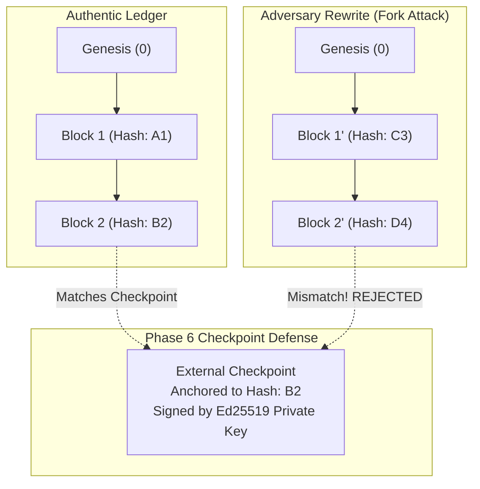

# MedTrustEdge Phase 6 — Threat Model and Security Boundary Analysis
## STRIDE Analysis, Single-Node Ledger Boundaries, and Cryptographic Trust Anchoring

---

## 1. System Overview and Architectural Context

**MedTrustEdge** is an AI-driven Zero Trust continuous authorization and verifiable audit architecture for Internet of Medical Things (IoMT) devices spanning Edge, Fog, and Cloud tiers.

In a healthcare computing environment, maintaining the cryptographic integrity of audit records is essential for regulatory compliance (e.g., HIPAA §164.312), forensic investigations of cyber incidents, and ensuring that compromised or anomalous medical devices cannot conceal their malicious actions.

### Architectural Trust Zones
1. **Edge Tier:** IoMT devices (ECG, SpO2, blood pressure sensors) and local Edge gateways. High physical vulnerability; constrained compute; potential point of device compromise.
2. **Fog Tier:** Intermediate regional aggregation nodes performing localized filtering, temporary privilege grants, and preliminary anomaly scoring.
3. **Cloud Tier:** Centralized management server storing master policy baselines and cross-tenant analytical models.
4. **Audit & Ledger Subsystem:** The hash-linked audit ledger capturing every Zero Trust policy decision, AI anomaly inference, and dynamic trust state transition.
5. **External Trust Anchor (Phase 6):** An out-of-band authority holding signing keys for periodic cryptographic checkpoints.

---

## 2. STRIDE Threat Analysis

| Threat Category | Healthcare / IoMT Risk Description | MedTrustEdge Countermeasures & Defenses | Verification Status |
|:---|:---|:---|:---:|
| **Spoofing Identity** | A compromised or rogue device impersonates an authorized IoMT sensor (e.g., spoofing MAC/IP of `iotA1`) to inject illegitimate telemetry or manipulate trust scores. | **Deterministic Identity Binding:** Phase 2 maps tenant ID, subnet (`10.1.1.0/24`), device ID, and destination port. In Phase 6, checkpoint signatures (RFC 8032 Ed25519) prevent attackers from publishing forged audit blocks under an unauthorized identity. | **VERIFIED** (Gate 2, 7) |
| **Tampering with Data** | An adversary with filesystem access modifies audit logs to conceal unauthorized access, flip policy decisions (`DENY` $\to$ `ALLOW`), or alter dynamic trust scores. | **Cryptographic Immutability:** Event payloads are normalized via RFC 8785 canonical JSON and hashed with SHA-256. Block Merkle roots and hash pointers link all records. Checkpoints anchor block hashes externally. | **VERIFIED** (Gate 4, 5, 6, 7; Attacks A–H) |
| **Repudiation** | An operator, application, or device denies executing a policy violation or altering device authorization states. | **Deterministic Non-Repudiation:** Record IDs are deterministically derived from unforgeable event attributes. Binary Merkle inclusion proofs provide mathematical non-repudiation of inclusion in sealed blocks. | **VERIFIED** (Gate 3, 5) |
| **Information Disclosure** | Interception or unauthorized extraction of Protected Health Information (PHI) or sensitive medical telemetry from the audit ledger. | **Zero-PHI Architecture:** MedTrustEdge ledger strictly records operational metadata (timestamps, IP addresses, service ports, trust scores, AI probabilities). No patient medical data, clinical readings, or diagnostic waveforms are stored. | **VERIFIED** (Schema Audit) |
| **Denial of Service (DoS)** | Flooding the ledger mempool with excessive events to exhaust gateway memory, or feeding malformed block headers to crash the verification engine. | **Centralized Resource Bounding:** Phase 6 configuration enforces strict batch sizing (`batch_size=5`), duplicate event rejection (`duplicate_policy="REJECT"`), fast logarithmic Merkle verification ($O(\log_2 B)$), and single-pass chain validation ($>8,500$ events/s). | **VERIFIED** (Gate 2, 10; Test Config) |
| **Elevation of Privilege** | A device in `RESTRICTED` or `REVOKED` state escalates access to unauthorized Fog/Cloud telemetry or obtains unauthorized diagnostic privileges. | **Dynamic Zero Trust Enforcement:** Deterministic policy engine immediately blocks unauthorized ports. Out-of-fold AI scores degrade trust scores. Dynamic trust transitions from `TRUSTED` $\to$ `RESTRICTED` $\to$ `REVOKED` enforce immediate network quarantine via iptables. | **VERIFIED** (Phase 2, 4, Gate 8) |

---

## 3. Threat Boundary Analysis: Single-Node Ledger vs. External Anchor

### 3.1 The Single-Node Whole-Chain Rewrite Vulnerability
In a single-node hash-linked audit ledger (such as implemented in Phase 5), the entire ledger file resides in local storage (e.g., `phase5_baseline_ledger.json`).
- **Internal Immutability:** Internal cryptographic checks prove that within a given ledger file, no individual block or event has been modified without breaking Merkle roots or SHA-256 hash pointers.
- **Vulnerability:** If an attacker gains administrative or write access to the filesystem, they can regenerate the entire blockchain from Genesis to tip with forged events. Because the attacker computes matching SHA-256 links and valid Merkle trees for their forged chain, a standalone `ChainVerifier` evaluating the altered file in isolation will find it internally consistent.

### 3.2 Phase 6 Checkpoint Defense Architecture
Phase 6 neutralizes whole-chain substitution by decoupling the verification trust anchor from the ledger file itself:
1. **Periodic Checkpoint Emission:** At regular block heights (or after critical security state changes), the system generates an immutable `LedgerCheckpoint` capturing:
   - `block_index`: Height of the checkpointed block.
   - `block_hash`: Authoritative SHA-256 tip hash.
   - `merkle_root`: Merkle root of the sealed block.
   - `cumulative_event_count`: Total events sealed up to this height.
   - `timestamp_utc`: Authoritative ISO 8601 UTC timestamp.
2. **Cryptographic Signing:**
   - **Ed25519 (Asymmetric):** Checkpoints are signed using an out-of-band private key held by a secure central auditing service or Hardware Security Module (HSM). The public key is widely distributed to verifiers.
   - **HMAC-SHA256 (Symmetric):** Checkpoints are authenticated using a high-entropy 256-bit secret shared between gateways.
3. **Independent Verification:** When `verify_ledger_against_checkpoint()` runs:
   - First, it verifies the digital signature or HMAC on the checkpoint payload.
   - Second, it verifies that the target block in the ledger matches the checkpointed `block_hash`, `block_index`, `merkle_root`, and event count.
   - Even if an attacker presents an internally consistent forged ledger, it is rejected because its tip hash does not match the cryptographically signed checkpoint.

---

## 4. Key Management and Trust Anchor Lifecycle

### 4.1 Key Generation and Storage Rules
1. **Zero Hardcoded Secrets:** Private keys and shared secrets must never be committed to source code or configuration files.
2. **Standard Cryptographic Entropy:** Keys must be generated using cryptographically secure random number generators (`os.urandom()` / `secrets.token_bytes()`).
3. **Algorithm Standards:**
   - Asymmetric: RFC 8032 Ed25519 (256-bit seed, Edwards25519 curve).
   - Symmetric: HMAC-SHA256 with 256-bit (32-byte) pre-shared keys.

### 4.2 Key Lifecycle and Rotation
- **Generation:** Keys are generated during initial gateway provisioning or deployment setup.
- **Distribution:** Ed25519 public keys are bundled into read-only verifier images. Private keys are restricted to the designated checkpointing service.
- **Rotation:** Checkpoints include the `key_id` in their canonical payload, allowing seamless key rotation without invalidating historical checkpoints signed under previous active keys.
- **Revocation:** In case of key compromise, affected key IDs are blacklisted in verifier configurations, and ledgers are re-anchored to fresh checkpoints signed by the successor key.

---

## 5. Residual Risks and Explicit Non-Goals

1. **Host-Level Compromise:** If an attacker achieves kernel or root execution privileges while the in-memory signing process is active, they can potentially extract ephemeral signing keys from RAM. In production, this must be mitigated using dedicated Hardware Security Modules (HSMs) or TPM 2.0 enclaves.
2. **Ingestion Channel Denial-of-Service:** Physical jamming or packet flooding on the wireless IoMT interface can prevent events from reaching the Edge gateway. The ledger guarantees auditability of received events, not physical channel availability.
3. **Single-Node Availability:** As a single-node audit ledger, MedTrustEdge does not provide distributed Byzantine consensus or automatic cross-node failover. High-availability clustering is outside the research scope.
